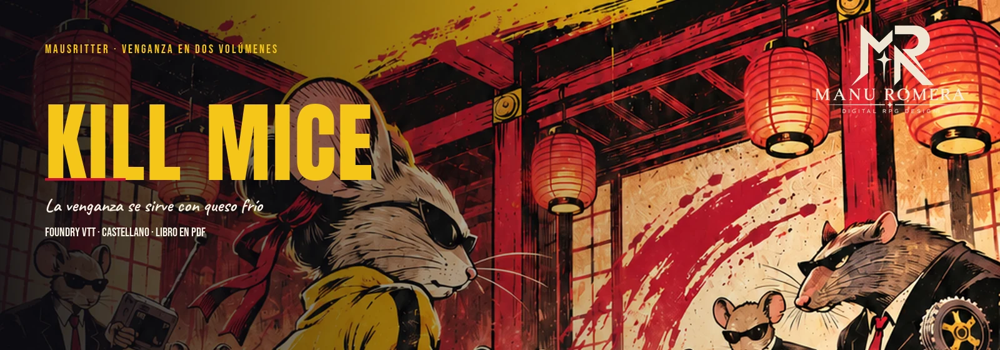
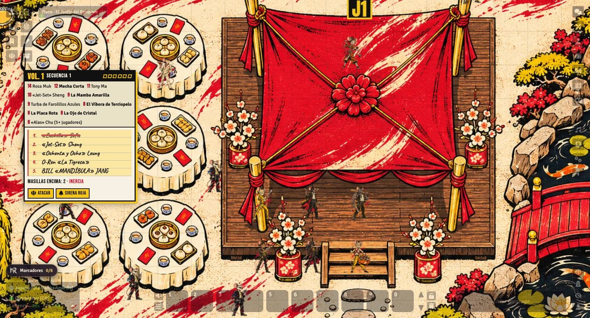
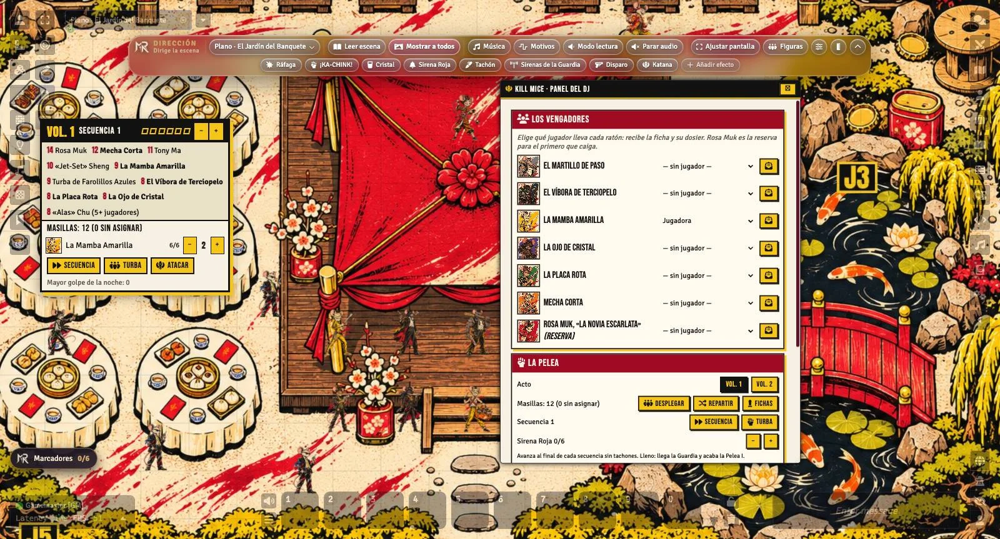

<p align="center">
  
</p>

<p align="center">
  <a href="https://github.com/ManuRomera"></a>
  <a href="https://github.com/ManuRomera/mr-kill-mice/releases/latest"></a>
  
  <a href="https://github.com/ManuRomera/mr-kill-mice/releases"></a>
  
  
  <a href="LICENSE"></a>
</p>

<h3 align="center">Una boda en el Jardín de los Mil Farolillos. Seis ratones que la Víbora Mortal dio por muertos.<br>Cinco nombres en cada lista. El último siempre es el mismo.</h3>

> [!IMPORTANT]
> **Necesita** el sistema **Mausritter** (`mausritter`, 0.6.1 o superior) en Foundry VTT **v13**. Convive con **MR- Mausritter en español** y **Mausritter Combat Carousel**.

## La aventura

**Kill Mice** es una aventura de venganza en dos volúmenes para Mausritter, de tres a seis jugadores. Bill «Mandíbula» Jang convirtió una boda en una masacre. Los supervivientes vuelven con una libreta amarilla y cinco nombres cada uno: primero el banquete de la Tríada en el Jardín de los Mil Farolillos y después la Casa de las Hojas Azules, con los 88 Maníacos esperando entre columnas de cristal. Es cine de artes marciales a escala de ratón, con katanas de bisturí y nunchakus de correa de reloj, y sin magia.

<p align="center"></p>

### Reglas propias de esta aventura

- **La Lista de Muerte.** Cada ratón lleva cinco nombres; los tenientes aparecen en varias listas. Tachar uno da Respiro de sangre, Inercia de venganza y, si el golpe era compartido, la Moneda de Fortuna. Con cuatro tachados se desbloquea el Golpe de los Cinco Puntos.
- **Los Masillas.** Los 88 Maníacos y los farolillos caen a montones: cada punto de daño abate a uno. En su turno, la Turba ataca y cada jugador elige entre esquiva acrobática o encajar el golpe.
- **Dados explosivos.** Sacar el máximo vuelve a tirar y suma, y cada explosión saca un giro de la tabla de pelea.
- **El reloj de la Sirena Roja.** Avanza en cada secuencia sin nombres tachados. En el Volumen 1 trae a la Guardia. En el Volumen 2 apaga las luces: siluetas azules y dados que explotan antes.
- **Bill pega más fuerte que el mejor golpe de la noche.** Tres condiciones nuevas: Sirena Roja, Aturdido y Magullado.

## Qué incluye

| | |
|---|---|
| Escenas | 13: once a pantalla completa con miniatura, música y la marca MR animada, más los planos del Jardín y de la Casa con zonas |
| Actores | 23: seis vengadores, Rosa Muk de reserva, catorce PNJ con técnicas y los dos tipos de Masilla |
| Objetos | 35: el arsenal reciclado, equipo, objetos clave, la Lista y las 3 condiciones |
| Diarios | Guía del Narrador por capítulos, siete dosieres con su Lista escrita a mano, ayudas de juego y «Cómo se juega en Foundry» |
| Tablas | 4: giros de pelea de cada volumen, sentencias al tachar y escenas postcréditos |
| Audio | 8 temas, 6 motivos, 3 ambientes y 14 efectos de koto, taiko, gong y funk, todos propios y en bucle sin corte |
| Macros | 7 |
| Libro | [PDF](docs/pdf/Kill-Mice.pdf) con la aventura, los dosieres, las Listas recortables y los planos |

### Herramientas de mesa

El módulo añade un grupo **Kill Mice** en la barra de herramientas de la escena.

- **Diálogo de ataque** para jugadores y Narrador. Recoge el arma y las técnicas de cada ratón y tira el dado explosivo. El daño a Masillas es carnicería y el daño a nombres pasa por armadura, PG y FUE.
- **Panel del Narrador:** reparto de personajes, Masillas por jugador, enemigos con sus técnicas, Listas y tachones, secuencias con iniciativa fija, escenas y tablas.
- **HUD «La Lista»**, arrastrable con el botón derecho. Cada jugador ve sus cinco nombres a rotulador y cuántos Masillas tiene encima; el Narrador, el reparto de la Turba. Cuando se tacha un nombre, todas las pantallas lo ven cruzarse en rojo.

<p align="center"></p>

### Convive con tus otros módulos de Mausritter

Las reglas de Kill Mice van en tarjetas y diálogos propios. No envuelven ninguna función del sistema ni tocan las tiradas nativas. Con **MR- Mausritter en español** y **Mausritter Combat Carousel** activos a la vez, cada uno hace lo suyo y nadie aplica el daño dos veces. El bloqueo de seis casillas solo afecta a los vengadores de esta aventura.

### Integración con MR- Dirección y MR- Pizarra (opcional)

- Con **[MR- Dirección](https://github.com/ManuRomera/mr-direccion)** activo, cada escena trae su lectura, su música y sus efectos propios.
- Con **[MR- Pizarra](https://github.com/ManuRomera/mr-pizarra)**, el botón de la chincheta prepara el tablero de quién va a por quién.

Sin ellos, todo funciona con las herramientas propias del módulo.

### Fichas, efectos y accesibilidad

- **Figuras de cuerpo entero sin fondo**, con opción de ficha redonda.
- **Efectos de sonido y destellos** al disparar, al tajar y al tachar, con volumen propio y desactivables. Los destellos respetan el movimiento reducido.
- **Texto grande y alto contraste** opcionales. Las ventanas recuerdan su posición y caben en cualquier pantalla.

## Instalación

1. En Foundry, **Instalar módulo** y pega el manifiesto:
   ```
   https://github.com/ManuRomera/mr-kill-mice/releases/latest/download/module.json
   ```
2. Activa el módulo en un mundo de Mausritter.
3. En un mundo vacío la aventura **se importa sola** al entrar como Narrador. En un mundo con contenido, impórtala desde el compendio.

Los personajes se entregan sin asignar: repártelos desde el panel del Narrador.

## Para quien edita

- El texto vive en `texto/aventura.md` y los datos (Listas, PNJ, arsenal, tablas) en `texto/datos.py`.
- `python3 tools/foundry.py` genera `_data/aventura.json`, las secuencias y los paquetes de Dirección y Pizarra. `npm run build` compila el compendio y el zip.
- `python3 tools/arte.py` prepara el arte, `python3 tools/audio.py` sintetiza la música y `python3 tools/libro.py` hace el PDF.

## Créditos y licencia

Historia y diseño: Manuel Romera Chinchilla. Módulo, libro, herramientas y revisión del texto y las reglas: Claude, bajo su dirección. Homenaje a *Kill Bill* de Quentin Tarantino y al cine de artes marciales de los setenta, sobre la premisa de *Red Packet Rumble* (Atlas Games). Imágenes generadas con IA y firmadas con la marca MR. Música y efectos de síntesis propia.

CC BY-NC-SA 4.0. Mausritter es de Losing Games. Es una obra de aficionado y no oficial. Detalles en [NOTICE.md](NOTICE.md).
